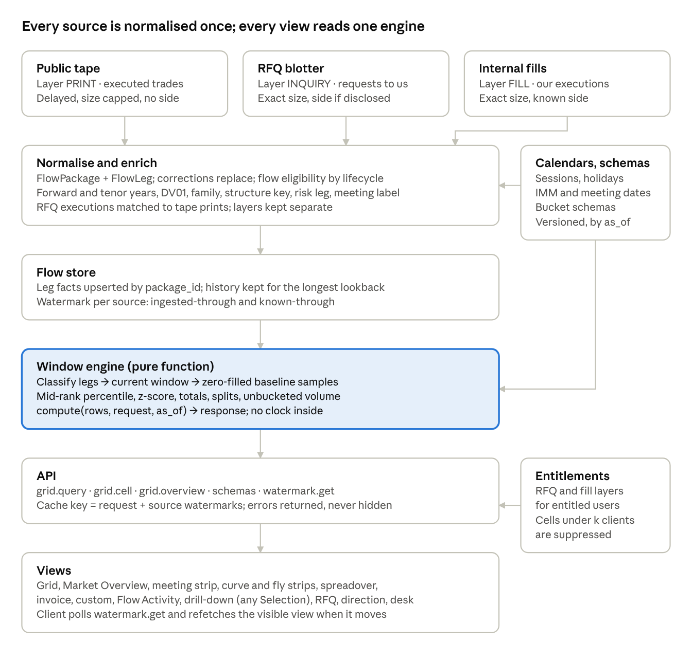
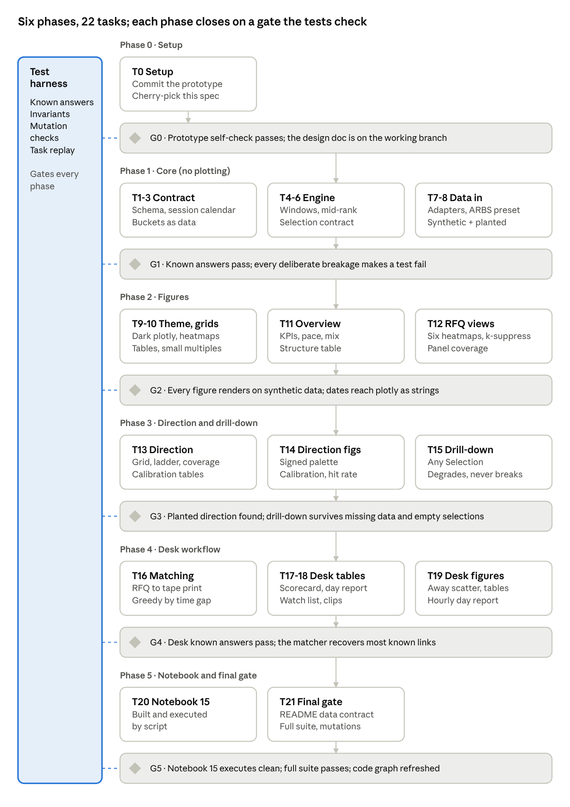

# VolumeGrid Flow Surface — Design Doc

Oct 6, 2026 · @Chris

VolumeGrid is a live heatmap of interest-rate swap flow: rows are forward-start buckets, columns are tenor (or named-structure) buckets, and each cell shows gross volume in the current window, coloured by its percentile against the same window on prior days. This doc specifies the data contract, bucketing, window and baseline maths, views, APIs and acceptance tests needed to rebuild it on any data stack, with public-tape prints, RFQ data, or both as sources. Where the reference build has a known defect, the spec states the corrected behaviour and marks it **Change from reference**.

**Revised 2026-10-11, after building a working prototype.** This revision adds:

- client/dealer direction analytics (a new section);
- a drill-down that takes any `Selection`, not just a grid cell;
- desk-workflow analytics modelled on how the desk uses the tape;
- a column contract with optional groups, so any feed can be mapped in;
- the design choices the prototype settled.

The step-by-step build plan is `docs/plans/2026-10-11-flowgrid-implementation.md`.

## Goals and non-goals

The grid answers one question at a glance: **where on the curve is flow concentrated right now, and is that unusual for this time of day?** A trader or salesperson should see within a few seconds which forward × tenor buckets (or named curves and flies) are running hot or cold against their own history.

**Questions it must answer**

1. Which forward-start × tenor buckets carry the most notional or DV01 in the current window?
2. How does each bucket compare with the same window on prior business days (percentile)?
3. How is each bucket's flow split by venue class (dealer-to-dealer vs dealer-to-client) and by package family (outright, curve, fly, spreadover, invoice)?
4. Which named structures (2s10s, 2s5s10s, meeting-dated, IMM-dated, swap spreads, invoice spreads) are active?
5. Which individual packages make up a cell, or any other selection of the flow (drill-down)?
6. With RFQ data: how much was asked for versus done, which side clients leaned, and what share we won.
7. Which side of the market dealers ended up on in each bucket, judged from a mid-based direction guess on each print, and is that unusual for the bucket?
8. How reliable is that direction guess, graded against prints whose side we know?
9. The desk's routine: where a lost RFQ actually traded and by how much we missed, per-client hit rates and net DV01, a client's day so far, which RFQs are still waiting for a print, and which prints are clips of one order.

**Users:** rates traders, sales, desk strategists, and automated agents that poll the API for unusual activity.

**Non-goals**

- Not a pricing or mid-market tool. Levels appear only as context in the drill-down.
- Not a P&L or position view. Cells are market flow, not the firm's inventory.
- Not a direction model. Direction guesses are input columns from an upstream producer; this product shows and grades them but does not make them. The base grid stays gross and unsigned. Signed views exist only where side is known (RFQ, internal fills) or supplied by a separate direction model, and they use a separate encoding (see Client/dealer direction).
- Not a cross-bucket "which tenor is busiest in absolute terms" ranking from inferred-side data. Percentiles compare each bucket with its own history.

The worked examples use USD SOFR swaps; every market-specific constant (bucket edges, venue codes, calendars, session hours) is configuration.

## Architecture at a glance



Sources feed one normalised store; the window engine is a pure function, so the grid, the drill-down and every test compute the same numbers from the same rows.

## Canonical data model

Every source is normalised into two tables, **FlowPackage** (one economic transaction or one RFQ inquiry) and **FlowLeg** (one swap leg of it). The grid aggregates legs; the drill-down lists packages. Nothing downstream reads a raw source.

**FlowPackage**

| Field | Type | Req. | Meaning |
| --- | --- | --- | --- |
| package\_id | string | yes | Stable id. Survives corrections; a correction replaces the row, never adds one. |
| source | enum | yes | PUBLIC\_TAPE, RFQ, INTERNAL\_FILL. |
| layer | enum | yes | PRINT (executed, from a tape), INQUIRY (an RFQ request, traded or not), FILL (executed, from your own records). |
| event\_ts | timestamp (UTC) | yes | Execution time for PRINT and FILL; request time for INQUIRY. For amended trades, the original execution time. |
| known\_ts | timestamp (UTC) | yes | When your system could first have seen it: dissemination time for a tape, request receipt for RFQ. Drives like-for-like baselines (see Windows and baselines). |
| package\_type | enum | yes | OUTRIGHT, CURVE, FLY, SPREADOVER, MATCHED\_MATURITY, INVOICE, INVOICE\_CALENDAR, INVOICE\_SWITCH, MEETING\_DATED, IMM\_DATED, BASIS, OTHER (and composite curve/fly variants of spreadover and matched-maturity). |
| package\_family | enum | derived | outright, curve, fly, invoice, other. Mapping in Measures. |
| structure\_key | string | derived | Canonical tenor key such as `2s10s` or `2s5s10s`; null for outrights. |
| venue\_class | enum | yes | D2D, D2C, BILATERAL, UNKNOWN. |
| venue\_id | string | no | Platform or MIC code. Mapping to venue\_class is configuration. |
| lifecycle | enum | yes | NEW, AMEND, CORRECT, CANCEL, TERMINATE, NOVATE, COMPRESS, OTHER. |
| flow\_eligible | bool | derived | Whether the package counts as market flow. Rule in Measures. |
| is\_block | bool | no | Block-size or delayed-dissemination flag. |
| label | string | derived | Human label (e.g. `SOFR 2Y10Y Curve`) used by the text filter. |
| level | number + unit | no | Fixed rate (percent) or package spread (bp). Always stored with an explicit unit field. |

**FlowLeg**

| Field | Type | Req. | Meaning |
| --- | --- | --- | --- |
| package\_id, leg\_index | string, int | yes | Parent and position. |
| currency, rate\_index | enum | yes | e.g. USD, SOFR. One grid instance per currency and index family. |
| trade\_date | date | yes | Business date of event\_ts in the session calendar. |
| effective\_date, maturity\_date | date | yes | Accrual start and end. |
| forward\_start\_years | number | derived | (effective\_date − trade\_date) / 365.25. Null only if effective\_date is missing. |
| tenor\_years | number | derived | Quoted tenor if the source gives one, else (maturity\_date − effective\_date) / 365.25. |
| notional\_abs | number | yes | Absolute notional in currency units. |
| notional\_capped | bool | yes | True when the source shows a capped size (public tape). |
| dv01\_abs | number | yes | Absolute DV01 in currency per bp. Method recorded in dv01\_method. |
| dv01\_method | enum | yes | SOURCE, ANNUITY\_APPROX, CURVE\_PRICED. |
| fixed\_rate | number | no | Percent. |
| is\_risk\_leg | bool | derived | The single leg that carries a structure's quoted risk. Rule in Measures. |
| meeting\_label | string | derived | Central-bank meeting the leg is dated to (e.g. `OCT26`), from the meeting calendar; null otherwise. |
| imm\_date | date | derived | IMM date the leg starts on, if any. |

**RFQ-only fields (on FlowPackage, layer = INQUIRY)**

| Field | Type | Meaning |
| --- | --- | --- |
| inquiry\_id | string | One id per client request. Quotes from several dealers never create several inquiries. |
| client\_side | enum | PAY\_FIXED, RECEIVE\_FIXED, UNKNOWN (two-way request for market). |
| outcome | enum | DONE\_WITH\_US, TRADED\_AWAY, NOT\_TRADED, EXPIRED, CANCELLED. |
| dealers\_in\_comp | int | Number of dealers asked. |
| fill\_package\_id | string | The FILL created when done, if any. |
| matched\_print\_id | string | The public-tape print this inquiry's execution matched, if any (see Sources). |
| client\_ref | string | Restricted. Never leaves the entitlement boundary; never in an aggregate response. |

**Sign convention, stated once.** Positive signed DV01 = the dealer **received** fixed = the client **paid** fixed = the dealer got longer duration. Every signed figure draws positive in blue and negative in orange. A client-perspective number, such as client net DV01 or RFQ client lean, is positive when the client paid, so it has the same sign.

**Column groups.** Columns come in groups, and each figure declares which groups it needs. A missing optional group switches off only the figures that need it:

| Group | Needed for | Columns |
| --- | --- | --- |
| core | every grid, strip and drill-down | the FlowLeg fields above, plus `leg_q` |
| session | derived from timestamps by the session clock | trade\_date, elapsed (wall-clock seconds since local midnight), known\_elapsed |
| direction | direction figures only | the direction fields below |
| level | the traded-rate-vs-mid panel only | fixed\_rate, mid\_rate |
| match | RFQ-to-tape joins | matched\_print\_id |
| desk | desk-workflow analytics | charge\_bp, away\_distance\_bp, we\_covered |

**Direction fields (one call per package, repeated on its legs).** An upstream producer compares each print with a mid at its timestamp:

| Field | Meaning |
| --- | --- |
| leg\_q | structure weight by tenor order: 1 \| (−1, 1) \| (−1, 2, −1); 0 for packages with no quote convention (PKG-N, basis) |
| mid\_rate | mid at execution, percent; null when unavailable |
| deviation\_bps | Σ q·(traded − mid) in bp: one structure-level number per package |
| b0\_bps | systematic mid bias removed before the call (0 when the feed does not publish it) |
| p\_client\_paid | probability the client paid fixed; null when no call |
| dealer\_side | RECEIVED \| PAID \| ABSTAINED |
| abstain\_reason | why there is no call; an **open set** (DEAD\_ZONE, OFF\_MARKET, NO\_MID, UNORIENTABLE\_PKG, NO\_CURVE, …) |
| dealer\_sign | +1 / −1 / 0 |
| signed\_dv01 | dealer\_sign × sign(leg\_q) × dv01\_abs, so a curve's two legs carry opposite signs |
| signed\_dv01\_w | signed\_dv01 weighted by conviction \|2p − 1\| (or the producer's signed weight) |
| dv01\_called | dv01\_abs when the package got a call, else 0 |

**Desk fields on inquiries:** `charge_bp` (how far our quote was from mid, against the client), `away_distance_bp` (where an away printed relative to mid), `we_covered` (we were second best).

## Sources: public tape, RFQ and internal fills

**Layers are never summed.** Every grid request names exactly one layer (PRINT, INQUIRY or FILL), or the explicit COMBINED\_EXECUTED layer defined below. An inquiry is interest and a print is a trade; adding them double counts every RFQ that traded.

| Property | Public tape (PRINT) | RFQ (INQUIRY) | Internal fills (FILL) |
| --- | --- | --- | --- |
| What it covers | Every reportable trade in the market | Requests sent to us only | Our executed trades |
| Side | Not disclosed; inferred only by a model | Disclosed in one-way RFQs; unknown in two-way requests | Known |
| Size | Capped above a regulatory threshold | Exact | Exact |
| Timing | Delayed: seconds for most, longer for blocks | Real time | Real time |
| Clock for windows | Execution time | Request time | Execution time |
| Counting unit | Leg, package | Inquiry (one per client request) | Leg, package |
| Bias | Complete market view, minus capped size | Panel bias: only clients who include us | Our share only |

**One inquiry, one count.** An RFQ sent to five dealers is one inquiry. If your data has one row per dealer quote, collapse to inquiry\_id before aggregating.

**Outcome drives which layer a row reaches.** Every inquiry stays in INQUIRY whatever its outcome. DONE\_WITH\_US also creates a FILL. TRADED\_AWAY should appear on the public tape as someone else's print; it never creates a FILL.

**Matching an RFQ execution to a tape print.** An executed RFQ (ours or traded away) normally also appears as a tape print. Link them when all of these hold, and only when exactly one candidate qualifies:

1. Same currency, rate index and package type.
2. Same effective and maturity dates on every leg (or tenor within one day when the tape omits dates).
3. Fixed rate within the tape's rounding (the team sets the tolerance, e.g. 0.01 bp).
4. Tape execution time within a tolerance of the RFQ execution time (the team sets it from observed reporting precision).
5. Notional equal, or the tape is capped and the RFQ notional is at or above the cap.

Ambiguous candidates stay unlinked. Track the match rate as a data-quality metric.

Prototype defaults that worked:

- same family and leg count;
- every tenor within 0.05 years;
- the print lands 0–240 minutes after the request;
- risk-leg DV01 within 15%, or the print is capped and no bigger.

Pairs are assigned greedily by time gap, each inquiry and each print used at most once. On synthetic data this recovered 97% of the known links.

**COMBINED\_EXECUTED layer** (optional): all PRINTs, with each matched print's capped notional replaced by the RFQ's exact notional and its side attached as known. Unmatched FILLs (off-tape trades) are added. This is the only layer that mixes sources, and it does so by enrichment, not addition.

**Reporting lag matters for intraday comparisons.** A tape's "today so far" lacks prints not yet disseminated, while the same slice on prior days is complete. The Windows and baselines section specifies the correction. RFQ and internal data have no such lag.

**Capped sizes.** Store the cap flag on every leg and report the capped share of each cell. Imputing a size above the cap is optional, must be labelled as imputed, and must take the cap table by effective date, since caps change over time.

**Panel bias in RFQ.** A single dealer's RFQ sample moves when clients add or drop that dealer. Baselines then shift for reasons unrelated to market activity. Publish a coverage series (inquiries per day, distinct clients per day) beside RFQ views so a regime shift is visible.

**Entitlements.** RFQ and fill data identify clients. Aggregates shown outside the entitled group must suppress any cell with fewer than *k* distinct clients (the team sets *k*). Drill-down rows for those layers require the entitlement. client\_ref never appears in an API response.

**Mapping a feed.** Each source gets one column map. Nothing downstream reads source columns. A column map has:

- renames and coalesce lists (first non-null wins, e.g. original execution time, else execution time);
- the rate unit (percent or decimal) and the time zone of naive timestamps;
- venue and side vocabularies (`VENUE_UNKNOWN` maps to `UNKNOWN`);
- constants for missing columns, and a row filter for flow eligibility.

When the feed lacks them, the adapter derives `leg_q` and the risk leg from package type and leg tenors.

**Two adapter rules.**

- **Never re-derive the dealer side from `deviation_bps`.** Producers call the side from deviation minus their bias estimate, which a tape view may not publish. Re-deriving would flip every print between 0 and the bias.
- **When a feed has no dissemination timestamp for a print, `known_ts` falls back to the execution time.** That print counts as known the moment it traded, which switches off the as-known filter for it. This is deliberate: a lag cannot be invented.

## Measures

A cell value is the sum of one measure over the flow-eligible legs that fall in that cell during the window. The base measures are gross and unsigned.

| Measure | Definition | Unit | UI label |
| --- | --- | --- | --- |
| Notional | Σ notional\_abs | currency | "Notional" |
| DV01 | Σ dv01\_abs | currency per bp | "DV01" |
| Legs | count of legs | count | "legs" |
| Packages | count of distinct package\_id | count | "packages" |
| Inquiries | count of distinct inquiry\_id (INQUIRY layer) | count | "inquiries" |

Counts always carry their unit in the label. **Change from reference:** the reference labels a leg count as "trades" in the grid and a package count as "trades" in the structure strips.

**DV01.** Use the source's DV01 when it provides one. Otherwise price the leg on the trade-date curve (CURVE\_PRICED), or fall back to the annuity approximation (ANNUITY\_APPROX):

```math
\mathrm{DV01} \approx N \cdot \sum_{i} \tau_i \, DF(t_i) \cdot 10^{-4}
```

where N is notional, τᵢ the fixed-leg accrual fractions and DF the discount factors. Record the method; mixing methods within one cell is allowed but should be visible in the drill-down.

**Dollar distance.** The desk quotes distance from mid both ways: "30k from mid" is USD and ".1 from mid" is bp. Store bp and derive USD as |deviation − bias| (bp) × the package's risk-leg DV01. Charges and away distances convert the same way, with the inquiry's DV01.

**Attribution modes** decide which legs of a multi-leg package count, and where.

| Mode | Rule | Used by |
| --- | --- | --- |
| ALL\_LEGS | Every leg counts in its own forward × tenor cell. A 2s10s curve adds to both the 2Y and 10Y columns. | Grid, FOMC strip, spreadover and invoice strips, Market Overview totals |
| RISK\_LEG | One leg per package, at the package's structure cell. | Curve and fly strips, Market Overview structure table |
| PACKAGE\_ADJUSTED | Σ \|leg DV01\| ÷ number of swap legs, assigned to the risk leg's cell. | Optional DV01 variant |

**Risk-leg rule:** curve → the longest-tenor leg; fly → the belly (middle leg by tenor); spreadover, matched-maturity and invoice → the swap leg; outright → its only leg; any other multi-leg package → the leg with the largest dv01\_abs. **Change from reference:** the reference sums all legs for structure volume in Market Overview but uses the risk leg in the strips; one rule per view is required.

**Package families** (for the family split bar and filters):

| Family | Package types |
| --- | --- |
| outright | OUTRIGHT, SPREADOVER, MATCHED\_MATURITY |
| curve | CURVE and its spreadover and matched-maturity variants |
| fly | FLY and its spreadover and matched-maturity variants |
| invoice | INVOICE, INVOICE\_CALENDAR, INVOICE\_SWITCH |
| other | everything else (basis, meeting-dated and IMM-dated packages not otherwise typed) |

**Flow eligibility.** A package counts as market flow only if its lifecycle event created new market risk. The rule is configuration with these defaults:

| Lifecycle | Default | Note |
| --- | --- | --- |
| NEW | in | The base case. |
| AMEND, CORRECT | in, as the latest version | The newer version replaces the old row; never count both. |
| CANCEL | out | Also removes the original. |
| NOVATE (incl. clearing novation) | out | Same risk, new counterparty. |
| COMPRESS, portfolio reset or optimisation | out | Risk reduction, not flow. |
| TERMINATE | out |  |
| Early termination booked as a new trade (unwind) | out, configurable | Open question for the team. |

**Splits always sum to the cell.** The venue-class split carries an UNKNOWN bucket and the family split carries "other", so D2D + D2C + BILATERAL + UNKNOWN equals the cell value exactly.

## Bucketing

One classifier assigns every leg to at most one row bucket and one column bucket, and every endpoint (grid, drill-down, overview, prefetch) calls that same classifier. Legs that land in no bucket are counted as **unbucketed** and reported, never silently dropped.

**Schema object**

| Field | Meaning |
| --- | --- |
| schema\_id, version | Stable reference. Requests carry both; dynamic schemas also carry as\_of. |
| axis | FORWARD or TENOR (row or column). |
| kind | YEARS (numeric ranges on forward\_start\_years or tenor\_years), LABEL (meeting\_label), CATEGORY (venue\_id), STRUCTURE (structure definitions). |
| buckets | Ordered list of {id, label, lo, hi}. lo is inclusive, hi exclusive, null means unbounded. |
| null\_bucket | Bucket id that receives null values (e.g. Spot for a missing effective date), or none. |

**Rules**

1. Buckets in one schema must not overlap. Validation rejects an overlapping schema at save time. **Change from reference:** the reference allows overlaps and classifies first-match in the grid but by plain range in the drill-down, so the two disagree.
2. Gaps are allowed (a strip may skip 4Y), but the response reports unbucketed volume per row and column.
3. Dynamic schemas (IMM, meeting, venue) are resolved server-side for an as\_of and returned with the bucket list the client should draw.
4. Calendars are data, not code: IMM dates are computed (third Wednesday of Mar, Jun, Sep, Dec) and meeting dates come from a maintained table. **Change from reference:** the reference hardcodes six meetings a year on the 15th of the month, and its list ends in 2027.

**Default forward rows (USD example)**

| Bucket | Range (years) |
| --- | --- |
| Spot | < 0.0192 (1 week), and null |
| 1W–3M | 0.0192 – 0.25 |
| 3M–6M | 0.25 – 0.5 |
| 6M–1Y | 0.5 – 1 |
| 1Y–2Y | 1 – 2 |
| 2Y–5Y | 2 – 5 |
| 5Y–10Y | 5 – 10 |
| 10Y+ | ≥ 10 |

**Default tenor columns (USD example).** Round-year buckets take the half year either side so a 2.4-year tenor lands in 2Y.

| Bucket | Range (years) | Bucket | Range (years) |
| --- | --- | --- | --- |
| 1M–3M | 0.083 – 0.25 | 6Y–7Y | 5.5 – 7.5 |
| 6M–12M | 0.25 – 1 | 8Y–9Y | 7.5 – 9.5 |
| 1Y–18M | 1 – 1.5 | 10Y | 9.5 – 10.5 |
| 18M–2Y | 1.5 – 1.85 | 10Y–12Y | 10.5 – 12.5 |
| 2Y | 1.85 – 2.5 | 12Y–15Y | 12.5 – 15.5 |
| 3Y | 2.5 – 3.5 | 15Y–20Y | 15.5 – 19.5 |
| 4Y | 3.5 – 4.5 | 20Y–25Y | 19.5 – 25.5 |
| 5Y | 4.5 – 5.5 | 25Y–30Y+ | ≥ 25.5 |

Tenors under one month are unbucketed in the default schema.

**Dynamic and special schemas**

| Schema | Axis | Buckets |
| --- | --- | --- |
| IMM16 | rows | The next 16 IMM dates, each ±0.125 years around its distance from as\_of (lower edge floored at 0). Labels like `Dec26`. |
| Meeting | rows | Distinct meeting\_label values from the calendar, from as\_of − 30 days onward, at most 16, in date order. Only legs with a meeting\_label count; all tenors are collapsed into one column. Aliases M1, M2… roll when a meeting's effective date passes. |
| Venue | columns | venue\_id values seen in the window: D2D venues first, then D2C, each alphabetical, then unknown codes. |
| Structure forward rows | rows | Spot (below max(1 week, IMM1 − 0.125)), IMM1–IMM4 (±0.125), 1Y, 2Y, 5Y (±0.125). A fixed row that overlaps an IMM row is clipped so rule 1 holds. |
| Structure columns | columns | Named structures (below). |
| Spreadover strip | one Spot row (< 0.125) × columns | 2Y 1.85–2.5, 3Y 2.5–3.5, 5Y 4.5–5.5, 7Y 6.5–7.5, 10Y 9.5–10.5, 20Y 19.5–21, 30Y 29.5–31. |
| Invoice strip | Front (< 0.25), Back (0.25–0.75) × columns | 2Y 1.5–3, 5Y 3–6, \~7Y 6–8, 10Y 8–12, 20Y 15–22, 30Y+ 22–35. |

**Direction ladder buckets (tenor):**

- 0–1Y, 1–2Y, 2–3Y, 3–5Y, 5–7Y;
- 7–10Y (to 10.5);
- 10–15Y, 15–20Y, 20–25Y, 25Y+.

A 30Y+ tail sat empty in an earlier draft, because 30-year legs fall below a 30.5 edge; 25Y+ fixes that.

**Named structures.** A structure is a set of tenors with a ±0.125-year tolerance. A package matches when its family is right, it has exactly that many swap legs, and each leg sits within tolerance of a different tenor in the set.

- Benchmark curves: 2s5s, 2s10s, 2s30s, 5s10s, 5s30s, 10s30s.
- Micro curves (adjacent): 1s2s, 2s3s, 3s4s, 4s5s, 5s6s, 6s7s, 7s8s, 8s9s, 9s10s, 10s12s, 12s15s, 15s20s, 20s25s, 25s30s.
- Wide curves: 2s7s, 2s20s, 3s5s, 3s7s, 3s10s, 3s30s, 4s10s, 5s7s, 5s20s, 7s10s, 7s20s, 7s30s, 10s15s, 10s20s, 10s25s, 15s30s, 20s30s.
- Benchmark flies: 2s5s10s, 2s5s30s, 2s10s30s, 5s10s30s.
- Micro flies: 1s2s3s through 20s25s30s along the adjacent tenor ladder (13 flies).
- Wide flies: 25 further combinations; the set is configuration.

**Custom schemas.** Users build a grid (forwards × tenors) or a strip (an explicit list of forward × tenor cells) from chips. A tenor or forward chip of *x* years becomes a bucket of ±0.125 when *x* ≤ 1, ±0.5 when *x* ≤ 5, and ±1.0 beyond; a forward chip of 0 becomes Spot. IMM and meeting chips are stored as references (IMM2, M3), not as frozen year bounds. **Change from reference:** the reference freezes those bounds at save time, so they drift, and its strip mode draws the full cross product instead of the chosen cells.

## Windows and baselines

Every cell compares the current window with *n* earlier windows of the same shape, ending at the same point in the business day, including the windows where nothing traded. The percentile of the current value among those samples sets the cell's colour.

**Session parameters** (per currency, configuration):

| Parameter | USD example | Note |
| --- | --- | --- |
| Time zone | America/New\_York | Elapsed time is measured on the local wall clock, so DST days line up. |
| Session open | 00:00 local | The reference uses midnight. A desk wanting an Asia open can move it. |
| Business calendar | Market holiday calendar for the currency | Holidays and weekends are not samples. |
| Effective session | The current business day, or the last one if today is not a business day | A weekend shows the last business day in full and says so in the header. |

**Periods**

| Period | Current window | Baseline samples |
| --- | --- | --- |
| today | \[session open, now) | Each prior business day in the lookback: \[open, open + elapsed) |
| 1h | \[now − 1h, now) | The same clock slice on each prior business day |
| 1d, 1w, 2w, 3w, 1m, 3m (1d was called 24h) | The last D business days up to now: from the same clock time D business days ago, to now. D = 1, 5, 10, 15, 21, 63. | k non-overlapping windows of the same length, stepping back D business days at a time. k = max(floor(lookback / D), k\_min), with k\_min = 4. |

**Change from reference:** the reference forms rolling baselines from calendar day, week, month and quarter buckets, including partial buckets at both ends, so its samples are not the same length as the current window.

**Zero-filled samples.** A sample with no eligible legs contributes 0, and n counts samples, not active samples. **Change from reference:** the reference samples only windows with activity, which moves quiet buckets' percentiles downward.

**Like-for-like with reporting lag.** For a delayed source, a print counts in a window only if it was known by that window's end: the condition is `known_ts ≤ window_end` for the current window and for every baseline sample alike. Without this, today's slice is missing undisseminated blocks while prior days are complete, so the current window reads low near now. For RFQ and internal fills, known\_ts equals event\_ts and the filter has no effect. Corrections apply to history (the latest version of each package is used).

**Percentile (mid-rank).** With baseline samples b₁…bₙ and current value x:

```math
P = 100 \cdot \frac{\#\{b_j < x\} + \tfrac{1}{2}\,\#\{b_j = x\}}{n}
```

If n < n\_min (the team sets it; 5 is a reasonable start) the percentile is null and the cell shows "insufficient history". The mid-rank matters once zeros are filled: under the reference's "count of samples ≤ x" rule, a bucket with five zero samples and a zero current window scores P100 (hot); mid-rank scores it P50.

Worked checks for the test suite:

| Baseline samples | Current | Mid-rank P | "≤" rule P |
| --- | --- | --- | --- |
| 0, 0, 0, 0, 0 | 0 | 50 | 100 |
| 0, 0, 10, 20, 30 | 15 | 60 | 60 |
| 0, 10, 20, 30, 40 | 40 | 90 | 100 |
| 10, 20, 30 (n = 3, n\_min = 5) | 25 | null | 67 |

**Baseline statistics returned per cell:** p25, p50, p75, min, max, mean, n and n\_active (samples with any activity), computed over the zero-filled samples.

**Totals have their own baseline.** Row, column and grand totals are windowed sums with their own samples and percentile; never an average of cell percentiles. **Change from reference:** the reference returns a null percentile for every total.

**Optional second statistic.** A z-score on log volume, z = (ln(1 + x) − mean ln(1 + b)) / sd ln(1 + b), computed over the same samples. It powers the Flow Activity colouring and is shown in the tooltip. The reference's Flow Activity view instead compares a 1h, 4h or 5-day window with a 20-day mean of full days; that mismatch is not carried over.

## Cell encoding

A cell shows its value as text and its percentile as background colour on a diverging blue–grey–red ramp: blue is quieter than usual, grey is typical, red is busier than usual.

**Colour ramp** (linear interpolation between stops, on the percentile 0–100):

| Percentile | RGB | Reads as |
| --- | --- | --- |
| 0 | 59, 76, 192 | much quieter than usual |
| 25 | 141, 176, 254 | quieter |
| 50 | 221, 221, 221 | typical |
| 75 | 244, 152, 122 | busier |
| 100 | 180, 4, 38 | much busier than usual |
| null | 30, 41, 59 | insufficient history |

Use light text when P ≤ 15 or P ≥ 90 and dark text otherwise. Insufficient-history cells also get a hatch pattern so they are not mistaken for a colour.

**Dark theme** (what the prototype ships). Ramp stops, from percentile 0 to 100:

| Percentile | Colour |
| --- | --- |
| 0 | #3987e5 |
| 25 | #24508f |
| 50 | #383835 |
| 75 | #8f3a26 |
| 100 | #e05a3a |

Typical cells recede to dark grey and the extremes glow. Use dark text on the bright ends (P ≤ 10 or P ≥ 90) and white elsewhere. Chart surface #1a1a19.

**Colour modes**

| Mode | Colour basis | Sub-label |
| --- | --- | --- |
| Activity (default) | Cell percentile vs its own history | `P73` |
| Grid | Cell value ÷ largest **visible** cell value × 100, on a one-hue sequential ramp | `G41` |
| Z (optional) | Log-volume z-score mapped to the same ramp, clamped at ±3 | `+1.8σ` |

Grid mode answers "where is the volume" and activity mode answers "where is it unusual"; the header says which is on.

**Change from earlier draft:** grid mode now uses a sequential ramp. A diverging ramp implies a midpoint, and raw volume has none.

**Cell contents**

- Main text: compact value (`1.2B`, `845K` DV01).
- Sub-label: the colour-mode tag above.
- Venue split bar (optional, bottom edge, 1.5 px): D2D share then D2C share, plus BILATERAL and UNKNOWN when present. The bar's colours must not reuse the ramp's, or the family bar's; the prototype draws the venue split in greys.
- Family bar (when the package filter is "all", top edge, 1 px): outright, curve, fly, invoice, other shares.
- Tooltip and accessible label: value with unit, count with its unit (legs or packages), window, comparison text ("vs the same 09:00–14:32 slice on 21 prior business days"), baseline p25, p50, p75, min, max, n, n\_active, venue split in value and percent, capped share for tape layers.

**Zero cells are information.** A cell with no flow this window but a busy history is cold: it gets its percentile colour, shows `0`, and stays clickable for its history. A cell with no flow and no history renders blank and disabled. **Change from reference:** the reference blanks every zero cell, hiding "nothing traded where something usually does".

**Total cells** (row, column, grand) use the same ramp with their own percentile, drawn with a heavier border.

**Signed views use a different palette.** When a view shows net side, colour it by sign, not by the activity ramp: blue (#3987e5) for dealer received fixed (clients paid), orange (#d95926) for dealer paid, and a neutral grey midpoint. The colour value is net ÷ the DV01 that got a call, in \[−1, 1\]. Red and blue already mean busy and quiet in this product, so signed views must say "blue = dealer received" in the title or legend. Known-side layers (RFQ, fills) and inferred-side layers (a tape direction model) carry different labels, and an inferred side is never compared across buckets on absolute level.

## Views

All views sit in one card with shared controls and a tab switcher; each view is a different bucket layout or summary over the same engine.

**Shared card controls** (persisted per user; a version key resets them when defaults change):

| Control | Values | Default |
| --- | --- | --- |
| Layer | PRINT, INQUIRY, FILL, COMBINED\_EXECUTED (only the layers the user is entitled to) | PRINT |
| Measure | Notional, DV01 | DV01 |
| Window | today, 1h, 1d, 1w, 2w, 3w, 1m, 3m | today |
| Lookback | 1w to 2y | 1m |
| Package group | all, outright, curve, fly, spreadover, invoice variants, meeting, IMM | all |
| Venue class | all, D2D, D2C | all |
| Text filter | Substring on package or leg label, same scope on every endpoint | empty |
| Colour mode | Activity, Grid, Z | Activity |
| Split | Volume, Venue split | Volume |

Every view honours every shared control, or shows the control disabled with a reason. **Change from reference:** the reference's Flow Activity view ignores the card's measure, window, lookback and filter.

**View catalogue**

| View | Question | Rows × columns | Attribution | View-specific controls | Cell click |
| --- | --- | --- | --- | --- | --- |
| Grid | Where on the surface is flow concentrated, and is it unusual? | Forward schema × tenor schema (Default, IMM16, Meeting rows; Default, Venue columns) | ALL\_LEGS | Schema pickers, hide-bucket popover | Drill-down |
| Market Overview | How busy is the whole market and what is it made of? | Panels (below) | ALL\_LEGS for totals, RISK\_LEG for structures | Structure picker, intraday bin size | Structure row → drill-down |
| Meeting strip | How much flow references each upcoming central-bank meeting? | One row of meeting cells, all tenors collapsed | ALL\_LEGS on legs with a meeting\_label | Absolute or M1/M2 labels | Drill-down on that meeting |
| Curve strip | Which named curves trade, and at which forward start? | Structure forward rows × curves | RISK\_LEG (longest leg) | Benchmark, Micro, All; column picker | Drill-down |
| Fly strip | Same for flies | Structure forward rows × flies | RISK\_LEG (belly) | Benchmark, Micro, All; column picker | Drill-down |
| Spreadover strip | How much swap-spread and matched-maturity flow is there per benchmark tenor? | Spot × seven benchmark tenors | ALL\_LEGS on spreadover packages | none | Drill-down with spread chart |
| Invoice strip | Where is invoice-spread flow, front vs back contract? | Front, Back × six tenor buckets | ALL\_LEGS on invoice packages | Outright, Calendar, Switch, All | Drill-down |
| Custom | Whatever layout the user defines | User grid, or an explicit list of cells (strip) | ALL\_LEGS | Schema builder, list, edit, delete | Drill-down |
| Flow Activity | Which buckets are hot or cold right now, in σ terms? | Default forward × default tenor | ALL\_LEGS | none (Z colour preset) | Drill-down |

Hidden buckets and hidden structure columns are removed from totals and from grid-mode scaling, or the totals are labelled "all buckets". **Change from reference:** the reference keeps hidden buckets in both.

**Market Overview panels**

1. KPI strip: total, its percentile, legs and packages, ADV, pace, DV01-weighted average tenor, block share, capped share. ADV is the mean full-session daily total over the lookback's business days, zero-filled. Pace is the current value ÷ the average value at the same elapsed time. **Change from reference:** the reference labels the mean of prior windows of the active period "ADV" and draws it across full-day bars.
2. Structure activity table: one row per spot structure\_key (e.g. `2s10s Curve`, `5Y Spreadover`), with last trade time, venue, last level with its unit, today's volume, ADV over 1 week and 1 month (zero-filled, risk leg), and pace (today ÷ the average at the same time) coloured from cold to hot; ADV 1M stays as a column for scale. Change from earlier draft: today ÷ full-day ADV compared a part day with a whole one.
3. Daily stacked bars over the lookback, by family, with the ADV line.
4. Package mix: current share vs historical average share per family.
5. Venue-class split: current vs historical.
6. Cumulative intraday curve: today vs the average cumulative curve over the full session.
7. Intraday bars at a chosen bin (1, 5, 10, 15, 30 or 60 minutes) with optional average bars.
8. Tenor distribution: current vs historical average per default tenor bucket.

**RFQ-native views** (shown only for entitled users; every cell below the minimum client count is suppressed):

| View | Cell value | Colour | Note |
| --- | --- | --- | --- |
| Inquiry grid | Requested DV01 or inquiry count (INQUIRY layer) | Activity ramp | Interest, whether or not it traded |
| Conversion grid | Executed ÷ inquired, by DV01 | Sequential, plus percentile vs own history in the tooltip | Show n next to every ratio |
| Win share | DONE\_WITH\_US ÷ (DONE\_WITH\_US + TRADED\_AWAY) | Sequential | Excludes NOT\_TRADED and EXPIRED |
| Client lean | (pay-fixed − receive-fixed) ÷ (pay-fixed + receive-fixed) on one-way inquiries | Signed palette: positive = clients pay = dealer receives = blue | Two-way requests excluded and counted separately |
| Market share | Our FILL DV01 ÷ COMBINED\_EXECUTED DV01 | Sequential | Needs the print-matching rule; shows match rate |
| Competition | Median dealers\_in\_comp | Sequential | Context for win share |

A coverage strip (inquiries per day and distinct clients per day over the lookback) sits above every RFQ view so panel changes are visible.

## Client/dealer direction

Each print carries a direction guess: an upstream producer compares the traded level with a mid at the print's timestamp. These views show where dealers ended up, whether that is unusual, and how far the guess can be trusted. They read only the direction fields in the data model, so any producer plugs in.

**How a print becomes a call** (the producer's rule, restated so the views can explain it):

```math
d = \sum_i q_i\,(r_i - m_i) \times 100, \qquad p = \frac{1}{1 + e^{-(d - b_0)/\tau}}
```

Here q = 1 for an outright, (−1, 1) for a curve and (−1, 2, −1) for a fly, by tenor order. r and m are the traded and mid rates in percent, b₀ is the mid bias and τ the steepness.

- Printing above mid (d − b₀ > 0) means the client paid, so the dealer received.
- A dead zone (|d − b₀| < 0.05 bp in the prototype), off-market prints (upfront-bearing, |d| > 4 bp) and prints without a mid get no call.
- A curve the client pays leaves the dealer long the long leg and short the short leg, so the legs carry opposite signs.

**Rules**

1. The side comes from the producer, never from re-reading `deviation_bps`.
2. The mid bias is estimated per venue class from earlier days only, never the day it is applied to.
3. Positioning views (direction grid, ladder, client lean) use **D2C prints only**. On a D2D print one dealer receives what another pays.
4. Each bucket is compared with its own history; levels are never compared across buckets.
5. **No cumulative "dealer inventory" across sessions.** The share of flow that gets a call changes day to day (dead zone, missing mids, panel), so a running sum drifts for reasons unrelated to positions. Daily net bars, z-scores and within-session cumulative lines are fine.

**Views**

| View | Shows | Encoding |
| --- | --- | --- |
| Direction grid | Net dealer DV01 by forward × tenor, today | Colour = net ÷ called DV01 in \[−1, 1\] on the signed palette; hover adds the oriented share and net's percentile against the same slice on prior days |
| Direction ladder | Each tenor bucket's daily net, z-scored against its own trailing 20 sessions, over **completed sessions only** (today's partial session would read near zero) | Bucket × session heatmap, signed palette clamped at ±3 |
| Bucket daily net | One bucket's daily net DV01 | Bars about zero, blue/orange; crosshair |
| Deviation to call | Distribution of (deviation − bias) by venue, with the p curve beneath | Histogram + line, dead zone shaded |
| Coverage | Share of DV01 per tenor bucket that got a call, and why the rest did not | 100% stacked bars; reason categories come from the data |
| Calibration | Predicted p against how often the client really paid, by decile of p | Reliability curve with a diagonal; the title states whether p is over- or under-confident |
| Hit rate by deviation | Accuracy by \|deviation − bias\| band, with the dead zone scored as if called | Bars with n; coin-flip line |

**Grading the guess.** An executed one-way RFQ discloses the client's side for the print it matched (see the matching rule in Sources), which gives labelled prints. On synthetic data the dead-zone band scored about 60% (close to a coin flip), against 76–100% outside it. That is the evidence for abstaining there.

## Drill-down

Clicking a cell opens a panel that explains that one cell: its history, its intraday shape, and the packages inside it. The drill-down must reproduce the cell's number exactly.

**Any selection, not just a cell.** A drill-down takes a `Selection`: every field is optional, and the set fields combine with AND. A grid cell is one case, built with `Selection.from_cell(rows, cols, row_id, col_id)` so it uses the grid's own half-open edges.

| Field | Meaning |
| --- | --- |
| name | title used on every panel |
| fwd | (lo, hi) forward-start years |
| tenor | list of (lo, hi) tenor ranges, OR-ed; a custom bucket set is one list, e.g. \[(1.85, 2.5), (9.5, 10.5)\] for 2s and 10s |
| package\_types, venues, meetings | allow-lists |
| structures | tenor tuples such as (2, 10) or (2, 5, 10); keeps whole packages that match |
| risk\_leg\_only | count each package once, at its risk leg |
| equals | allow-list on any column, e.g. {client\_ref: \[…\]}, {rate\_index: \[SOFR\]} |
| where | escape hatch: any boolean filter |

The prototype demonstrates three selections: a grid cell (Spot × 10Y, which reproduces the cell exactly), a custom bucket (spot 4Y–7Y D2C outrights) and a structure (2s10s at the risk leg).

**Shared-predicate rule.** The drill-down request is the grid request plus a cell id. It carries the same layer, filters, measure, window and the full schema reference (schema\_id, version, as\_of, or the custom bucket list). The server classifies with the same classifier. The client never rebuilds a schema and the server never falls back to a default. **Change from reference:** the curve and fly strips open the drill-down with the default forward schema, so every row except Spot is rejected as an unknown bucket, and Spot silently uses the wrong edge.

**Panel contents**

1. **Header:** selection name, window, as-of, and the value and percentile.
2. **Daily history:** one bar per business day over a selectable range, zero-filled, with a dashed median line; today's bar is marked partial. When direction data exists, net dealer DV01 per day sits beneath it as bars about zero. Crosshair.
3. **Intraday shape:** today's cumulative curve against the average baseline day and the busiest prior day, with a marker at the last update. Crosshair.
4. **Why this percentile:** today's value plotted against the n baseline samples that set the percentile, with p25, p50 and p75.
5. **Prints against mid:** for one session, each print on the deviation-from-mid axis (net of bias), shaped by call (▲ dealer received, ▼ dealer paid, ● no call) and sized by DV01, with the dead zone shaded. Beneath it, cumulative net dealer DV01 today against the average day. A traded-rate-vs-mid panel is added on top only when the selection is a single tenor and mids exist; levels of different tenors must not share an axis. Off-market prints are pinned to the edge and counted in the title.
6. **Packages in the selection:** newest first, with time, type, venue, legs, package and in-selection DV01, risk-leg rate, and the call (side, deviation − bias, p, no-call reason).
7. **Orders:** today's prints grouped into orders, where clips of one spec on one venue within 30 minutes count as one order (see Desk workflow).
8. **Layer extras:** INQUIRY rows show outcome, side (if entitled) and dealers in competition. PRINT rows that matched an RFQ show a matched badge.

**Parity.** For the current window, the sum of in-cell contributions across all packages in the cell equals the grid cell value. If the package list is truncated, the panel shows "showing 50 of N" and the full sum still matches.

**Missing data degrades the panel, never breaks it.**

- An empty selection returns an empty-state figure that says so.
- No direction columns: the net row and the call columns disappear, and the prints panel names the columns it needs.
- No mids: the level panel is dropped.

**Bin convention.** Intraday bins are \[start, end) and are plotted at their start time. The convention is written into the API response (`bin_anchor: "start"`) so a chart cannot shift trades by one bin.

**Hover prefetch** is optional. If built, it calls the exact request builder that the click uses, so the cached entry is the one the click reads.

## Desk workflow

The desk watches the SDR all day and posts what it learns in chat. These analytics compute those posts from the RFQ blotter and the tape. Typical lines (names removed):

- "A real-money client paid 275k 10y away, 30k from mid, we showed 64k charge."
- "Traded away in multiple smaller clips (50, 25, 25)."
- "It's been an hour since we saw the 7y; still not on SDR, probably didn't trade."
- "193 RFQs, 1.81x the 20-session average … 42 wins, 59 aways, 29 covered … net paid 1.51mm DV01."

| Analytic | What it answers | Rule (prototype defaults) |
| --- | --- | --- |
| RFQ-to-print matching | Which print did an executed RFQ become? | The rule in Sources: same family and leg count, tenors within 0.05y, print 0–240 min after the request, DV01 within 15% or capped; greedy by time gap |
| Away analysis | Where did a lost RFQ trade, and by how much did we miss? | Per away: charge, away distance, miss = charge − away distance, each in bp and in USD (× DV01). Scatter of our charge against the away distance; aways more than 2 bp from mid are left out and counted |
| Client scorecard | A client's hit rate, net DV01 and distances, by tenor | Last 10 business days, by client × tenor bucket: RFQs, inquiry DV01, wins, aways, hit rate = wins ÷ (wins + aways), client net DV01 (+ = paid, executed only), average away distance, average charge |
| Client day report | Is today unusual for this client? | Today's slice against the client's own same-time slice on prior 20 days: RFQ count and DV01 ratios; wins, aways, covered; hit rate morning and afternoon (split at 12:00); away distance morning and afternoon; net paid DV01; curves-and-flies share. Rendered as chat-ready text plus an hourly figure |
| SDR watch list | Which RFQs are still waiting for a print? | Today's RFQs not done with us and not yet matched: waiting (< 15 min), overdue (< 60 min), likely not traded (≥ 60 min) |
| Clip aggregation | Which prints are pieces of one order? | Same package type, tenors and forward bucket on one venue, each within 30 min of the previous, form one order. Side is reported inside the order, not used to split it, so a dead-zone clip does not start a new order |

These read the inquiry desk fields and the tape; none of them needs the direction columns, though orders report the call mix when it exists. PCA-equivalent risk of fly packages ("pays 64k belly 5s10s30s, receives 123k 7y") is out of scope; it needs a curve risk model.

## API contracts

Six operations serve every view. Transport (REST, gRPC, GraphQL) is the team's choice; the shapes below are JSON, and every request is a single object so the same builder serves click, poll and prefetch.

| Operation | Input | Output | Notes |
| --- | --- | --- | --- |
| `schemas.list` | currency, as\_of | Resolved schemas with bucket lists | Dynamic schemas (IMM, meeting, venue) resolved for as\_of |
| `schemas.saveCustom` | Custom schema object | schema\_id, version | Rejects overlaps and empty bucket lists |
| `grid.query` | GridRequest | GridResponse | One call per view render or poll |
| `grid.cell` | CellRequest | CellResponse | Drill-down |
| `grid.overview` | GridRequest without axes | OverviewResponse | Market Overview panels |
| `watermark.get` | none | Per-source ingested-through and known-through times | Cheap poll; refetch a view only when it moves |

**GridRequest**

```json
{
  "currency": "USD",
  "index_family": "SOFR",
  "layer": "PRINT",
  "measure": "dv01",
  "window": "today",
  "lookback_days": 30,
  "rows": { "schema_id": "fwd_default", "version": 3 },
  "cols": { "schema_id": "tenor_default", "version": 2 },
  "collapse": null,
  "package_group": "all",
  "venue_class": "all",
  "text": null,
  "as_of": null
}
```

`as_of: null` means now; a fixed as\_of makes the response reproducible and is what tests use. Custom schemas may be sent inline as `{ "inline": { "buckets": [...] } }` instead of a schema\_id.

**GridResponse**

```json
{
  "as_of": "2026-10-06T14:32:05Z",
  "watermark": { "PUBLIC_TAPE": { "known_through": "2026-10-06T14:31:58Z" } },
  "session": { "date": "2026-10-06", "tz": "America/New_York", "fallback_reason": null },
  "window": { "kind": "time_of_day", "start": "...", "end": "...", "n_samples": 21 },
  "units": { "value": "USD per bp", "count": "legs" },
  "axes": {
    "rows": { "schema_id": "fwd_default", "version": 3, "buckets": [{ "id": "spot", "label": "Spot" }] },
    "cols": { "schema_id": "tenor_default", "version": 2, "buckets": [{ "id": "10y", "label": "10Y" }] }
  },
  "cells": [{
    "row": "spot", "col": "10y",
    "value": 845000, "legs": 42, "packages": 31,
    "percentile": 81.0, "z": 1.4,
    "baseline": { "p25": 310000, "p50": 520000, "p75": 700000, "min": 0, "max": 1900000, "mean": 560000, "n": 21, "n_active": 19 },
    "split": {
      "venue_class": { "D2D": 400000, "D2C": 430000, "BILATERAL": 0, "UNKNOWN": 15000 },
      "family": { "outright": 600000, "curve": 200000, "fly": 45000, "invoice": 0, "other": 0 }
    },
    "capped_share": 0.12,
    "last_event_ts": "2026-10-06T14:30:41Z"
  }],
  "totals": { "rows": {}, "cols": {}, "grand": { "value": 0, "percentile": null, "baseline": {} } },
  "unbucketed": { "value": 0, "legs": 0 },
  "suppressed_cells": 0
}
```

The numbers are illustrative. Cells absent from the list have value 0 and no history.

**CellRequest** = GridRequest + `{ "cell": { "row": "spot", "col": "10y" }, "range": "3M", "intraday_date": null, "recent_limit": 50 }`. Structure views put the structure id in `col`.

In the library implementation the drill-down takes a `Selection` (see Drill-down) instead of a cell id. A cell id converts with `Selection.from_cell`, so a service can keep this request shape and build the selection server-side.

**CellResponse** carries `header` (the grid cell as above), `daily` (array of {date, value, legs, packages, spread\_bp?, partial}), `intraday` ({bin\_minutes, bin\_anchor: "start", today: \[...\], average: \[...\], overlay: \[...\]}), and `packages` (array with in-cell contribution and legs), plus `packages_total` for the untruncated count.

**Errors** return a machine code and the offending field, e.g. `{ "code": "unknown_bucket", "field": "cell.row", "schema_id": "fwd_default" }`. The UI shows every error in the view; it never keeps drawing stale data silently.

## Computation and freshness

Start with leg-level facts queried per request, and keep all window and percentile maths in one pure module; add a pre-aggregated cube only if measured latency demands it.

**Pipeline**

1. Ingest each source into its raw store.
2. Normalise to FlowPackage and FlowLeg.
3. Enrich: trade\_date and session, forward\_start\_years, tenor\_years, dv01\_abs, package\_family, structure\_key, is\_risk\_leg, meeting\_label, imm\_date, venue\_class, flow\_eligible, RFQ-to-print match.
4. Upsert by package\_id, so a correction replaces its row.
5. Advance the source's watermark (ingested-through and known-through).

**Two ways to aggregate**

| Approach | How | Strength | Limit |
| --- | --- | --- | --- |
| A. Query leg facts per request | Columnar engine scans legs over lookback + current window, classifies with the schema, groups by sample | Any schema, including custom, with no precomputation | Cost grows with lookback × volume; size it from your own data |
| B. Minute cube | Pre-sum by (session date, minute of session, layer, venue class, family, package group, fine forward bin, fine tenor bin, meeting label, structure key) | Sub-second for fixed schemas | Fine bins must contain every schema edge; custom edges that cut a fine bin fall back to A |

Both paths call the same module: `compute(legs_or_cube_rows, request, as_of) → response`. It is a pure function with no clock or I/O inside, so a fixed as\_of reproduces any past screen.

**Freshness**

- Cache key = the canonical request + the watermark of every source the layer reads. A new print moves the watermark, so the next poll recomputes; nothing else expires the cache.
- Any HTTP cache lifetime must not exceed the poll interval; prefer validators (an ETag equal to the cache key). **Change from reference:** the reference serves a 30-second poll from responses cached for up to 300 seconds, plus stale-while-revalidate, so the grid can be minutes old.
- Clients poll `watermark.get` on a short interval (the team sets it), refetch the visible view only when the watermark moves, pause while the tab is hidden, and discard any response older than the newest one already drawn.
- The response header shows the as-of time and each source's known-through time, and turns amber when a source lags beyond a threshold.

**Late and changed data**

- Incremental ingestion advances on an ingest sequence or known\_ts, never on event\_ts. A late-reported trade has an old event\_ts and would be skipped by an event-time cursor.
- Corrections and cancels update history. The watermark moves, so baselines recompute on the next poll.
- An RFQ inquiry is windowed by request time. Its outcome can change later (to done or expired); that changes conversion and win-share views but never moves the inquiry to another window.

**Determinism checks:** the same request, as\_of and data version must give a byte-identical response. Responses carry the schema versions and calendar version used.

## Pitfalls from the reference build

Twenty-two defects in the reference build each map to a requirement in this spec; the first seven change what users see most often. "Code" means the behaviour was confirmed in source; "review" means it was found by code review and not re-run.

| # | Reference behaviour | Effect | Requirement here | Basis |
| --- | --- | --- | --- | --- |
| 1 | Curve and fly strip drill-downs send the default forward schema | Every row but Spot is rejected; Spot uses the wrong edge | Shared-predicate rule; parity test for every view × bucket | Code |
| 2 | Grid responses cached up to 300 s (plus stale-while-revalidate) under a 30 s poll | Screen can be minutes old while looking live | Cache keyed by watermark; lifetime ≤ poll interval | Code |
| 3 | Baselines sample only windows with activity | Quiet buckets read hotter than they are | Zero-filled samples over business days | Code |
| 4 | Percentile = share of samples ≤ current | With zeros, a dead bucket scores P100 | Mid-rank percentile, n\_min | Code |
| 5 | Rolling baselines use calendar day/week/month/quarter buckets with partial ends | Samples differ in length from the current window | Non-overlapping, equal-length business-day windows | Code |
| 6 | Row, column and grand totals return a null percentile | Totals are never coloured | Totals get their own baselines | Code |
| 7 | Meeting calendar hardcoded: six a year on the 15th, ending 2027 | Wrong meeting aliases; real meetings unlabelled | Maintained calendar table | Code |
| 8 | "Trades" is a leg count in the grid and a package count in the strips | Counts compared across views disagree | Explicit unit on every count | Code |
| 9 | Market Overview "ADV" is the mean of prior windows of the active period | Wrong unit against full-day bars | ADV = mean full-session daily total | Code |
| 10 | Drill-down shows spread × 10,000, Market Overview × 100, both labelled bp | 100× disagreement on one field | Store spread with an explicit unit; tie out | Code |
| 11 | Flow Activity uses a UTC date, compares 1h or 5d windows with a full-day mean, ignores card controls | z-scores biased by window length | Same engine and samples as the grid | Code |
| 12 | Zero cells rendered blank and disabled | "Nothing where something usually trades" is invisible | Cold colour, clickable | Code |
| 13 | Strip bucket gaps (e.g. 4Y, 12–15Y) drop legs silently | Totals understate flow | Report unbucketed volume | Code |
| 14 | Structure volume sums all legs in Market Overview but the risk leg in strips | Two numbers for one structure | One attribution rule per measure | Review |
| 15 | Overlapping custom buckets: first match in grid, plain range in drill-down | Drill-down includes legs the grid gave to a neighbour | Reject overlaps; one classifier | Review |
| 16 | Custom strip mode draws the cross product of chosen rows and columns | Cells the user did not pick appear | Strip = explicit cell list | Review |
| 17 | Hidden buckets stay in totals and in grid-mode scaling | "% of max visible" is wrong | Recompute or label totals | Review |
| 18 | Weekend: grid shows Friday, drill-down intraday uses the calendar date | Empty intraday chart on weekends | One effective-session resolver | Review |
| 19 | Hover prefetch omits the text filter and custom buckets | Cache misses; errors on every hover in Custom | Prefetch uses the click's request builder | Review |
| 20 | Picking "Custom" with no buckets sends an invalid request and the view keeps old data | Silent failure | Never send incomplete schemas; show errors | Review |
| 21 | The trade-tape poll advances on execution time | Late-reported trades never appear until reload | Ingest cursor on known\_ts or sequence | Review |
| 22 | Text filter matches package and leg labels on one endpoint, package label only on another | Filtered totals disagree across views | One filter scope everywhere | Review |

**Found while building the prototype (2026-10).** Each was caught in the prototype and is now guarded by a test.

| # | Trap | Effect | Requirement |
| --- | --- | --- | --- |
| 23 | Re-deriving the dealer side from the raw deviation | Flips every print that sits between 0 and the mid bias | Take the side from the producer |
| 24 | Estimating the mid bias with the day it is applied to | The call leaks its own outcome | Bias from earlier days only (a known-answer test pins it) |
| 25 | Including D2D prints in a positioning view | Dealer-to-dealer recycling shows up as client positioning | Positioning views are D2C only |
| 26 | Scoring today's partial session in a daily ladder | Today always reads near zero | Ladder covers completed sessions; today lives in the direction grid |
| 27 | Plotting rates of different tenors on one level axis | A tenor bucket shows a saw-tooth that is just tenor mix | Level panel only for a single-tenor selection; otherwise deviation only |
| 28 | Client-lean panel signed from the client side, other views from the dealer side | Same flow is blue in one view, orange in the next | One convention: positive = client paid = dealer received |
| 29 | Hard-coding three abstain reasons | Real producers emit more (unorientable packages, no curve) and the coverage shares stop summing to 100% | Categories built from the data |
| 30 | A ladder bucket edge at 30.5y | 30-year legs fall into 20–30Y and the 30Y+ row is permanently empty | Edges chosen so standard tenors fill every bucket |
| 31 | Dates handed to the charting library as raw datetime64 arrays | Axes labelled 1.78e18 (plotly 6) | Pass dates as strings |
| 32 | A test of the bias rule built on a 5-day window | Shifted and unshifted medians coincide, so the test passes with the rule removed | Every rule gets a deliberate-breakage check |

## Testing and acceptance

The engine is accepted when three kinds of check pass: invariants that hold for any data, fixtures whose answers were computed by hand, and mutation checks that prove each test can fail.

**Invariants** (property tests over generated legs and random as\_of values)

1. Partition: every eligible leg lands in exactly one cell or in unbucketed, so Σ cells + unbucketed = Σ eligible legs.
2. Venue and family splits sum to their cell exactly.
3. Totals equal the sum of the cells they claim to cover.
4. Percentile lies in \[0, 100\] and never falls as the current value rises with the baseline fixed.
5. Grid–drill-down parity, for **every view and every bucket**, including dynamic ones: the drill-down header equals the grid cell, and in-cell contributions sum to it. This one test catches pitfall 1.
6. Determinism: identical request, as\_of and data version give an identical response.
7. Layer isolation: no response mixes INQUIRY with PRINT or FILL; COMBINED\_EXECUTED volume ≤ PRINT volume with exact sizes + unmatched FILL volume.
8. Lag safety: for a fixed window, evaluating it at an earlier as\_of never increases its value.

**Known-answer fixtures** (small synthetic datasets with expected outputs written by hand before the code runs)

| Area | Case | Expected |
| --- | --- | --- |
| Percentile | The four rows in Windows and baselines | As tabled there |
| Bucket edges | Leg at exactly 0.25y forward; leg at 1.85y tenor | 3M–6M row; 2Y column (lower edge inclusive) |
| Nulls | Leg with no effective date | Spot row |
| Session | as\_of on a Saturday | Last business day in full, fallback\_reason set |
| Session | DST start and end days in the lookback | Slices aligned on local clock time |
| Session | Holiday in the lookback | Holiday is not a sample; n drops by one |
| Lifecycle | Correction, cancel, clearing novation | Corrected version once; cancelled removed; novation excluded |
| Structures | 2s10s with legs at 2.1y and 9.9y; legs at 2.2y and 10y; fly with two legs near the same tenor | Match; no match (tolerance 0.125); no match |
| Reporting lag | Block executed 10:00, known 10:20 | Excluded at as\_of 10:10, included at 10:30; same on a baseline day |
| RFQ | One inquiry quoted by five dealers | One inquiry |
| RFQ | Inquiry done with us, matching a capped tape print | COMBINED\_EXECUTED counts it once at the exact size |
| RFQ | Two tape prints equally close to one fill | Left unlinked; match rate falls |
| Calendars | Meeting calendar fixture with an October meeting | M1 aliases to the October label until its effective date passes |

**Direction and desk known answers.**

| Case | Expected |
| --- | --- |
| An outright printed 0.5 bp above mid | dealer RECEIVED, signed DV01 > 0 |
| A 2s10s curve whose 10y leg printed 0.5 bp above mid (client paid the spread) | RECEIVED; the 10y leg is positive and the 2y leg negative |
| Daily bias medians \[0, 0, 0.3, 0.3, 0.3\] then a 0 day, with a 6-day window | Bias for the last day = 0.3 (0.15 if the day itself leaked in) |
| Ladder: 21 days alternating ±1, then +10 | z of the last day = 10 |
| Coverage with RECEIVED 50, UNORIENTABLE\_PKG 30, NO\_CURVE 20 | Categories in that order, shares sum to 1, called share 0.5 |
| ".3 from mid" on a 100k-DV01 package | 30k from mid |
| Away with charge 0.233 bp, away distance 0.109 bp, DV01 275k | Miss 0.124 bp; 30k from mid; 64k charge |
| Client with a win (pay 100k), an away (pay 200k) and a not-traded (receive 50k) | 3 RFQs, hit rate 50%, client net +300k |
| RFQs waiting 5, 30 and 90 minutes | waiting, overdue, likely not traded |
| Prints at 10:00, 10:10 (dead zone) and 10:50 of one spec, 30-minute gap | Two orders; the first has 2 clips, with the dead-zone clip reported as no call |
| Matching with an earlier print, a wrong tenor, a too-big print, and a capped one | Only the right print matches; the capped print matches a larger RFQ |

**Mutation checks.** For each rule below, break it on purpose and confirm at least one test fails. A test that still passes with its rule removed is not testing that rule.

- Remove zero-filling.
- Replace mid-rank with "≤".
- Compute sessions in UTC instead of the session time zone.
- Allow overlapping buckets with first-match classification.
- Drop the known\_ts filter.
- Let the drill-down fall back to a default schema.
- Sum INQUIRY into PRINT.
- Flip the dealer side (deviation > 0 → PAID).
- Drop sign(leg\_q) from signed DV01, so curve legs stop offsetting.
- Let the mid bias use the current day.
- Let the ladder's trailing window include the day itself, or include today's partial session.
- Let the matcher accept a print earlier than the request.
- Remove the drill-down's no-direction-columns branch.

**Golden responses.** Store full API responses for a handful of fixed as\_of values on real data, and review diffs in code review whenever the engine changes.

## Delivery plan

The build plan is `docs/plans/2026-10-11-flowgrid-implementation.md`: 22 tasks in six phases, turning the prototype into a tested package (`SDRUtils/flowgrid`) and a notebook that draws every figure. No phase starts until the gate above it passes.



Every code block in that plan was built into a scratch copy of the repo and replayed task by task before it was handed over. Each task's tests pass at its own point in the sequence, and the full suite (74 tests) passes at the end. The desk-workflow phase depends on nothing after it, so it can be dropped or deferred without touching Phases 1–3.

**Handoff to each agent:** the task text, which names the exact files, the interfaces it consumes and produces, the tests to write first, the code, and the deliberate-breakage checks to run. A task is done when its gate's checks pass, not when its code compiles.

## Open questions

These decisions belong to the implementing team; the spec works with the stated default until each is settled. Ticked items were settled while building the prototype.

- [x] Default sign for signed views: **decided**, dealer perspective (positive = dealer received = client paid); client-perspective numbers carry the same sign.
- [x] Is COMBINED\_EXECUTED needed in the first release? **Decided: no.** Layers stay separate; the matching rule is built and the enrichment layer is a follow-up.
- [x] n\_min and default lookback: **decided**, n\_min 5 and 21 business days. The longest supported lookback (which sets data retention) is still open.
- [ ] Session open: midnight local (default), or an earlier open to capture the Asia session?
- [ ] Unwinds and early terminations booked as new trades: flow or not? Default: not flow.
- [ ] Capped tape sizes: show the capped share only (default), or impute sizes above the cap, and from which distribution?
- [ ] Minimum client count *k* for RFQ aggregates (the prototype uses 3), and which groups are entitled to the RFQ and fill layers.
- [ ] DV01 source: which curve and as-of for CURVE\_PRICED, and is ANNUITY\_APPROX acceptable for display?
- [ ] Direction producer settings: the dead zone (0.05 bp in the prototype) and the steepness τ, tuned against labelled prints with the calibration view.
- [ ] Watch-list thresholds: one 15/60-minute rule, or per tenor and block status (blocks disseminate later)?
- [ ] Currencies and indices beyond USD SOFR, and their bucket sets and calendars.
- [ ] Poll interval, latency targets and the source-lag threshold that turns the header amber.
- [ ] PCA-equivalent risk for fly packages: which risk model, and where it should show.
